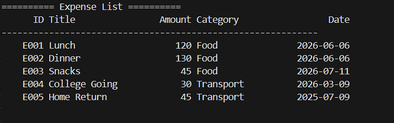

# Expense Tracker CLI

A small, modular Python command-line application for recording expenses and understanding where money goes.

I built this project to move beyond single-file exercises. The expense tracker gave me a practical reason to separate user interaction, validation, file storage, and analysis into different modules.

## At a glance

- Add an expense with a title, positive whole-number amount, category, and date.
- View saved expenses and delete a record by its ID.
- Calculate total spending, summarize it by category, and filter by category.
- Store records locally in a JSON file that is created when needed.
- Run entirely in the terminal using Python's standard library.

## Screenshots

| Menu | Expense records |
| --- | --- |
|  |  |

**Category summary**


## Getting started

Requires **Python 3**. No third-party packages are needed.

Clone the parent repository:

```bash
git clone https://github.com/Rafidabd/python-phase-1.git
cd python-phase-1
```

Run the tracker **from the repository root**:

```bash
python day13_Mini_Projects/expense-tracker-cli/main.py
```

**Important:** The current implementation uses a path relative to the repository root for expense storage. Running `python main.py` after entering the project folder is **not** the documented startup method.

## Using the tracker

The interactive menu provides seven options: add an expense, list expenses, delete an expense, show total spending, see a category summary, filter by category, or exit.

When entering a record:

- **Amount:** a positive integer (for example, `250`); decimal amounts are not currently supported.
- **Date:** `YYYY-MM-DD` (for example, `2026-03-10`).
- **Category:** one of the names in [`config/categories.json`](config/categories.json), such as Food, Transport, Education, or Health.

Example of the record structure:

```json
{
  "id": "E001",
  "title": "Lunch",
  "amount": 250,
  "category": "Food",
  "date": "2026-03-10"
}
```

The example is illustrative; no expense record is bundled for you.

## Project structure

```text
expense-tracker-cli/
├── assets/                # README screenshots
├── config/
│   └── categories.json   # Allowed categories
├── modules/
│   ├── analytics.py      # Totals, filtering, category summaries
│   ├── cli.py            # Interactive terminal menu
│   ├── config_loader.py  # Category configuration
│   ├── display.py        # Formatted terminal output
│   ├── expense_manager.py# Adding, reading, deleting expenses
│   └── storage.py        # JSON read/write and ID generation
├── main.py
└── README.md
```

The program creates its local `data/expenses.json` file when required. That file is ignored by Git and is not intended to be committed.

## What I learned

This was an opportunity to practice modular design, JSON file handling, input validation, local persistence, and separating calculations from presentation code.

### Current scope and limitations

This is an educational, single-user CLI—not a bank integration or a production finance tool. It uses local JSON rather than a database, accepts whole-number amounts only, and depends on being launched from the parent repository root because of its current storage path.

A future improvement would be to resolve storage relative to the project's directory so it can be run from any working directory.
