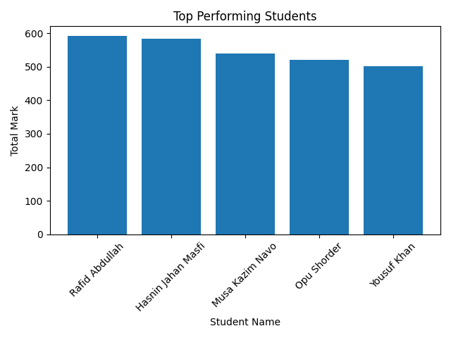
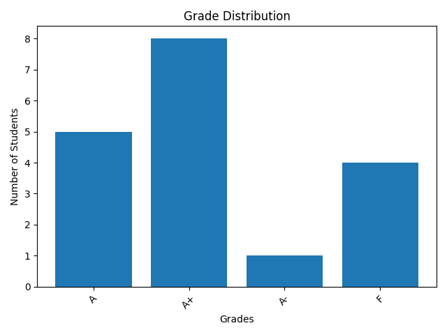

# Student Performance Tracker

A Python command-line application that stores student records, analyzes class performance, and produces charts and CSV reports.

I built this while learning how to move from individual scripts to a multi-module application. Beyond recording marks, I wanted to answer questions about rankings, section-level performance, and grade distributions.

## Demo


## Features

**Student records**
- Add, view, edit, and delete student entries.
- Store student IDs, names, sections, and subject marks in a local JSON file.
- Validate marks against the configured range.

**Academic summaries**
- Rank students by total marks and identify overall and subject toppers.
- Calculate class and section averages and identify section toppers.
- View the top N students and filter by section or pass/fail result.

**Reports**
- Generate charts for top performers, pass/fail counts, section averages, and grade distribution using Matplotlib.
- Export a class leaderboard as CSV.

## Example visualizations

| Top performers | Pass / fail |
| --- | --- |
|  |  |

| Section averages | Grade distribution |
| --- | --- |
|  |  |

## Getting started

**Requirements:** Python 3 and Matplotlib.

Clone the parent repository, then **run the application from its own folder** so relative data and report paths resolve correctly:

```bash
git clone https://github.com/Rafidabd/python-phase-1.git
cd python-phase-1/day13_Mini_Projects/student-performance-tracker
python -m pip install -r requirements.txt
python main.py
```

The program presents an interactive menu for student management, statistics, charts, and exports.

## Configuration and data

[`config.json`](config.json) defines the college label, sections, subjects, permitted mark range, passing mark, grade bands, and the JSON data-file path.

By default, the program stores student records in `data/students.json`. The file is created if absent and is ignored by Git. Generated reports use the `Reports/` directory; example chart images and a sample leaderboard are included in this repository.

Use sample or consented data. Avoid committing real students' personal records to a public repository.

## Structure

```text
student-performance-tracker/
├── Demo/                    # Animated CLI demo
├── Reports/                 # Example charts / exported leaderboard
├── modules/
│   ├── analytics.py         # Rankings and statistical calculations
│   ├── cli.py               # Command-line menu
│   ├── config_loader.py     # Reads config.json
│   ├── display.py           # Terminal output formatting
│   ├── export.py            # CSV leaderboard export
│   ├── storage.py           # JSON persistence
│   ├── student.py           # Student record operations
│   ├── utils.py             # Report directory helper
│   └── visualize.py         # Matplotlib charts
├── tests/                   # Early test / inspection script
├── config.json
├── main.py
├── requirements.txt
└── README.MD
```

## What this project taught me

I practiced organizing a program across modules, making configuration-driven calculations, validating input, handling local JSON data, exporting structured results, and communicating those results visually.

### Status and limitations

This is an educational CLI application, not a production student-information system. It uses local JSON rather than a multi-user database. The existing `tests/` directory contains early testing material, but a comprehensive automated test suite has not been established here.

The newer [Bangladesh Academic Analytics System](../../academics_analytics_system/) is a separate project where I have continued exploring more involved academic analysis.
